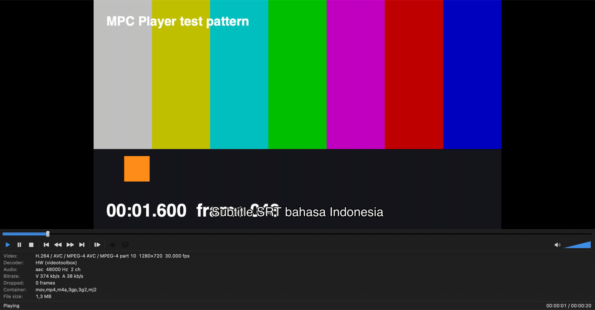
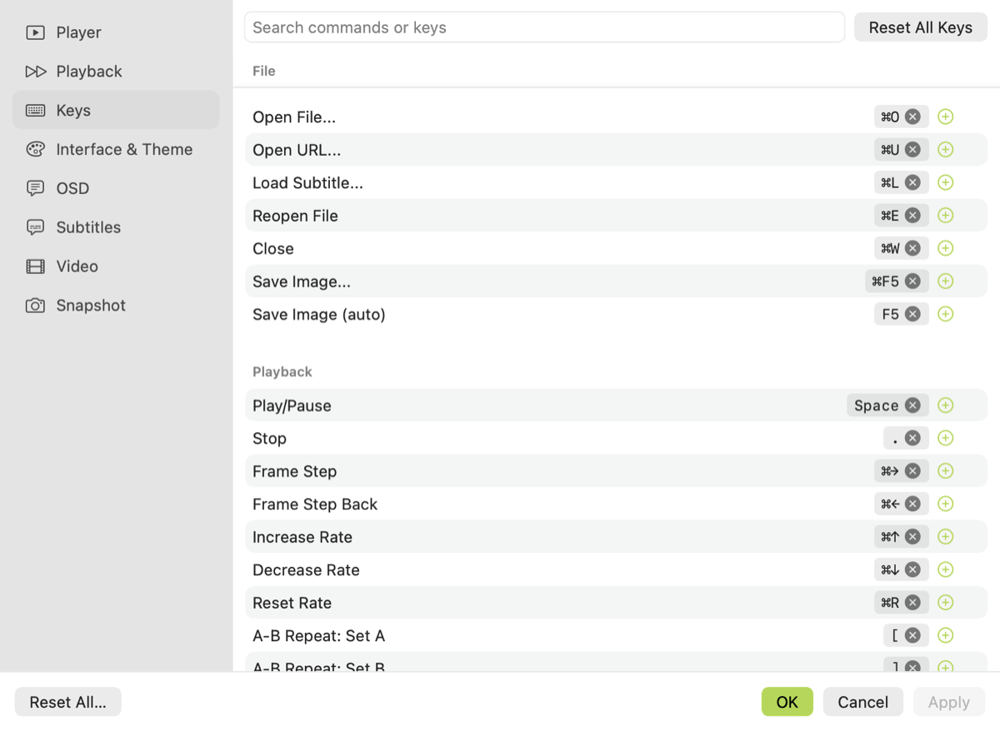

*Setup: MacBook with Apple Silicon, macOS 26. The app needs macOS 14 or later. It was built with Swift and the Command Line Tools, without Xcode.*

**[Download MPC Player 0.1.0 for Apple Silicon Macs](/downloads/MPC-Player-0.1.0-macOS-arm64.zip)** (15.7 MB). See [Download and install](#download-and-install) first, because macOS blocks the first launch.



*The main window with the Statistics panel open. This image comes from the app's self-test, which combines the interface with a frame from mpv.*

## What it's for

MPC-BE (Media Player Classic – Black Edition) is a video player that many people know from Windows, but it has no Mac version. MPC Player brings that way of working to macOS:

- The familiar layout: a seek bar, a toolbar with the volume wedge, status, information and statistics panels, a docked playlist, and a large right-click menu.
- Keyboard-first control, with defaults based on MPC-BE's own key table. Ctrl generally becomes ⌘.
- Wide format support through libmpv and FFmpeg, including MKV, AVI, WebM, HEVC and AV1, plus ASS and SRT subtitles.
- Everyday player features: resume position, A-B repeat, frame stepping, speed control, audio and subtitle delay, pan and scan, snapshots, and VideoToolbox hardware decoding.

It isn't a port of MPC-BE, and it isn't affiliated with that project. We read MPC-BE's open-source code as a reference for the interface, features and default keys, and wrote the player separately in Swift.

## The main feature: keys you can really make your own

The hotkey system is the reason to choose this player. Almost everything the player does is a named command, and Options › Keys lets you change the keys for all of them.



Here's what you can do:

| You can | Details |
|---|---|
| **Remap every command** | All 89 commands are listed, across File, Playback, Navigate, View, Video, Audio, Subtitles and Misc |
| **Give one command several keys** | Press **+** as many times as you like, for example `Space`, `K` and `⌃P` for Play/Pause |
| **Use any modifier combination** | Any mix of ⌘, ⌃, ⌥ and ⇧ with letters, symbols, arrows, F-keys, Home/End or Page Up/Down |
| **Bind commands with no default key** | Small and large jumps, brightness, contrast, saturation and aspect ratio start without a key, so you can pick your own |
| **Remove keys you don't want** | Each key has its own **×**, which also frees it for another command |
| **Find things quickly** | Search by command name or by the key itself, such as `F5` |
| **See conflicts straight away** | A key assigned to two commands turns red, so you can fix it. Until you do, only one of those commands responds |
| **Undo safely** | Reset one command or all keys. **Cancel** throws away the session's changes, and **Apply** or **OK** keeps them |

A few details make this comfortable to use:

- **Recording captures ⌘ chords too.** The recorder reads the key press before the menu bar can take it, so `⌘O` can be recorded instead of opening a file.
- **Plain keys don't steal your typing.** Single-letter hotkeys are ignored while you're typing in a text field, such as the search box.
- **Menus show your keys.** Your ⌘ shortcuts appear in the menu bar, and the right-click menu shows each command's first key.
- **Your changes survive updates.** Only the commands you changed are stored, so a new default in a later version won't overwrite your choices.

There are limits. Keys are keyboard chords only, so there are no mouse-button bindings or multi-key sequences like `g g`. There are no key profiles or import/export yet. Plain `Esc` can't be recorded, because it cancels recording.

The design behind this is small. Every action is one enum case, each case has its default keys, and the user's changes are laid over those defaults:

```swift
public init(overrides: [String: [KeyBinding]]) {
    for cmd in PlayerCommand.allCases {
        let keys = overrides[cmd.rawValue] ?? cmd.defaultBindings
        b[cmd] = keys
        for k in keys where l[k] == nil { l[k] = cmd }
    }
}
```

Menus, the keyboard handler and the editor all use the same map, so they stay in agreement.

## How we built it

### 1. Picking the engine

Apple's AVFoundation doesn't cover formats like MKV or ASS subtitles, so we used **libmpv** through [MPVKit](https://github.com/mpvkit/MPVKit), which provides prebuilt libraries. We chose MPVKit's LGPL build rather than its GPL build.

### 2. Reading MPC-BE's source

MPC-BE is open source, so there was no need to analyze its binary. Its command table gave us the list of actions and their default keys, and the rest of its source was a reference for the interface.

### 3. Keeping the project simple

The project is a Swift package with three parts, and a short script assembles the `.app`:

```
PlayerCore     mpv wrapper, commands and keys, preferences, resume history
PlayerUI       SwiftUI interface, Options window, AppKit integration
MPCPlayerMac   app entry point and self-test
```

### 4. Using AppKit for the app itself

With a SwiftUI `Window` scene, the main window never appeared when a file path was passed at launch. We switched to a plain AppKit app with an `NSWindow` hosting the SwiftUI interface. This also gave us full control of the menus and key handling.

### 5. Testing without Screen Recording permission

The app has built-in self-test flags that run commands, log the video geometry and save a snapshot:

```bash
MPCPlayer test.mp4 --steps start,presetMinimal,togglePlaylist,playPause --quit-after 8
```

This is how we found the bug in the next section.

## The bug that changed the renderer

We first rendered through mpv's `wid` option with Vulkan and MoltenVK. It worked until you changed the layout: after switching view presets or opening the playlist, the picture stayed the wrong size and could be cut off.

The self-test log (trimmed here) showed why. The layer changed size, but mpv kept rendering at its old one:

```
presetMinimal   drawable=1600x1040   mpv=1600x896
togglePlaylist  drawable=1078x896    mpv=1600x896
```

MPVKit's MoltenVK context only reads the layer size when the video reconfigures, and its control function does nothing, so a resize never reaches mpv. mpv's general resize path is only triggered by options that exist on Android and Windows builds.

So we moved to **libmpv's render API**, with `vo=libmpv` drawing into a `CAOpenGLLayer`, the approach IINA also uses. Each frame is now drawn at the layer's current size. After the change, mpv's size matched the layer in every case we logged: playing, paused, view presets, playlist, zoom and fullscreen.

That move had one side effect. Snapshots failed with `Input image format videotoolbox not supported by libswscale`, because screenshots in this mode only run on the render thread when `MPV_RENDER_PARAM_ADVANCED_CONTROL` is on. Turning it on fixed snapshots and kept hardware decoding.

The trade-off is that OpenGL is deprecated on macOS, although it still works, and this path doesn't give full HDR (EDR) output.

## What was and wasn't tested

- **Self-test:** playback of a generated MP4 with hardware decoding, ASS and SRT subtitles, resume, speed, A-B repeat, the panels, snapshots and the video geometry above.
- **Not covered by the self-test:** physical key presses, including recording keys in the editor, the right-click menu, and drag and drop. The self-test calls commands directly.
- **Not tested with sample files:** real MKV and AVI files. Support for them comes from libmpv and FFmpeg.
- **Known issue:** Zoom 200% on a large video can make the window bigger than the screen.

## Download and install

| | |
|---|---|
| **App** | [MPC-Player-0.1.0-macOS-arm64.zip](/downloads/MPC-Player-0.1.0-macOS-arm64.zip) (15.7 MB) |
| **Requires** | Apple Silicon Mac, macOS 14 or later. Intel Macs aren't supported by this build |
| **SHA-256** | `436bbc2509ca07af6fed3a6a5c941372e4630c23279cb4ad296bf2483ea5f639` |
| **Source** | [MPC-Player-0.1.0-source.zip](/downloads/MPC-Player-0.1.0-source.zip) (1.4 MB) |

1. Unzip the file and drag **MPC Player.app** to Applications.
2. Open it. macOS will refuse, because the app is ad-hoc signed and not notarized by Apple.
3. Go to **System Settings › Privacy & Security**, scroll down, and click **Open Anyway** next to MPC Player.

To open videos with it by default, select a video in Finder and press ⌘I. Under **Open with**, choose MPC Player and click **Change All…**.

### License

MPC Player links mpv and FFmpeg statically, and both are LGPL in this build. The app zip includes the license notices, and the source package is there so you can rebuild the app against modified versions of those libraries. See `NOTICES.txt` for details.
