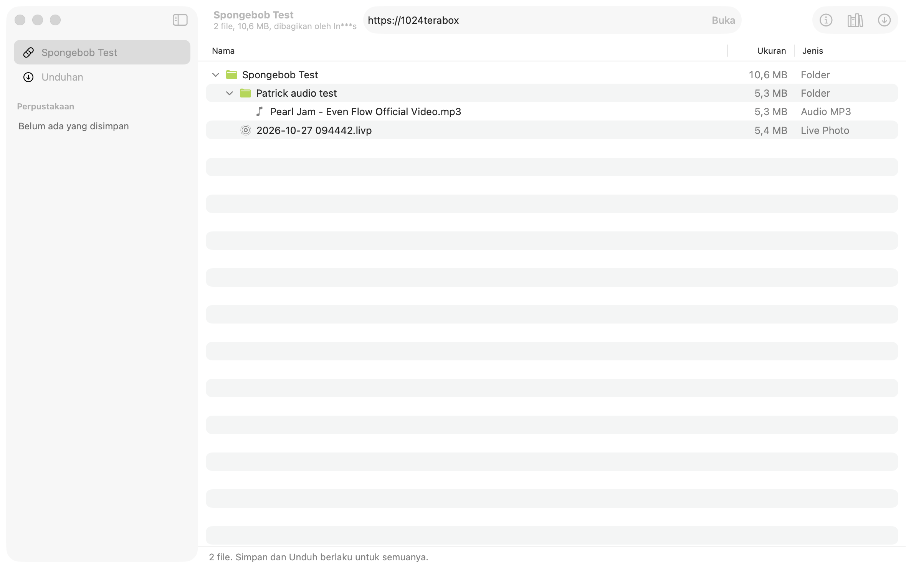
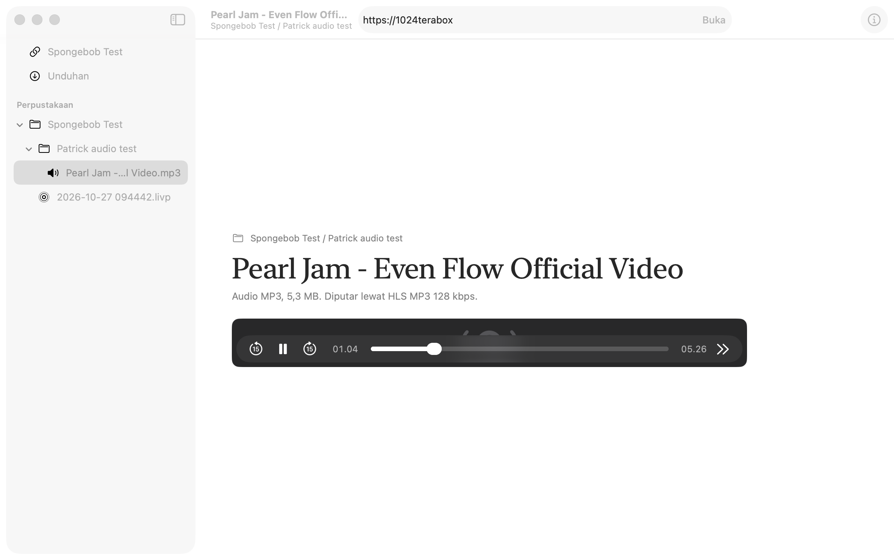

*Setup: MacBook with Apple Silicon, macOS 26.5, Xcode 26.5, Swift 6 with strict concurrency. The app needs macOS 26. It started as a 1,000-line Python script and grew into a 5,600-line SwiftUI app over about four days.*

**[Download Terabox Stream 1.1 for Mac](/downloads/Terabox-Stream-1.1-macOS.zip)**. Read [Download and install](#download-and-install) first, because macOS blocks the first launch. The full source is in [Terabox-Stream-1.1-source.zip](/downloads/Terabox-Stream-1.1-source.zip) under the MIT license.

*Updated 2026-11-08 for version 1.1: videos start right away again, a chosen quality falls back to other qualities, and big files download over 8 connections. The logbook entries #13 to #15 cover how those were found.*



*A small test share in list view. The share's ID is hidden in the link field. This screenshot is from the first build: the grid, thumbnails and library checkboxes came later. The interface is in Indonesian, because that is who it was built for, so English names are given in brackets below.*

## What it's for

Terabox gives away a lot of free storage, so people share big folders of video through it. Its share page is slow to browse, though, and to watch anything you either sit in their web player or download whole files first.

Terabox Stream treats a share link like a folder on your Mac:

- **Paste a link and see everything.** Every folder and subfolder appears as one tree, or as a YouTube-style grid with thumbnails.
- **Stream in the app.** Double-click a video or song and it plays in a native macOS player, with seeking. The file itself is never saved to disk.
- **Preview by hovering.** Rest the pointer on a video card and it plays silently: 4 seconds at 1/5 of the video, then 2/5, 3/5, 4/5, then the last 4 seconds, then back to the start.
- **Save the link, not the file.** "Simpan" (Save) writes one tiny `.tblink` file per item into a library folder. It holds the share link and the file's ID, about 500 bytes. Opening it later fetches a fresh stream. My library of 271 saved items takes almost no disk space.
- **Download when you want a real copy.** Pick files, or tick them in the library, and they download one by one, with resume and the original folder structure.
- **Log in once.** A login window inside the app picks up your session and stores it in the macOS Keychain. You never copy a cookie by hand.

There is also a command-line version, `terabox.py`, in the source package. It needs only Python 3 and shares the same library format, so the app and the script can use the same `.tblink` files.

> This is an unofficial client. It talks to the same web API that Terabox's own site uses, so it can break whenever Terabox changes that API. Use it for files you are allowed to access, and treat your login session like a password.

## How to use it

### Open a share

Paste a link into the field at the top and press Return. ⇧⌘V opens whatever link is on the clipboard. Links with an access code ask for the code. A link that already ends in `?pwd=abcd` is unlocked automatically.

**Daftar** (List) shows a tree with name, size and type columns. **Grid** shows cards grouped by folder. Switch with the toolbar control, ⌘1 or ⌘2. The ⓘ button opens an inspector with the file's details.

### Play

Double-click any audio, video or image. The player opens on top of the page, and the **‹** button or ⌘[ takes you back to exactly where you were, with the same scroll position and the same folders open.



- Video streams over Terabox's own HLS stream. On automatic quality the app tries 720p, then 480p, then 360p. Change it with the quality menu in the toolbar or **Pemutaran › Kualitas Video** (Playback › Video Quality). If the quality you chose isn't available, the app tries the others before it falls back to the original file, which is slow on a free account.
- Audio plays from the original file, with an automatic switch to Terabox's HLS audio when the file can't be seeked.
- The line under the title says which source is playing: the original file, or HLS and its quality.

### Save to the library

⌘S saves the open share, or just the selected items, to the library. The library mirrors the share's folders and shows up in the sidebar under **Perpustakaan** (Library). Click an item to play it. `.tblink` files also open from Finder with a double-click.

The default library is `~/Terabox Stream/Perpustakaan`. You can move it in Settings (⌘,), for example to the folder `terabox.py` uses.

### Tick and download from the library

- Click a card, or the round check that appears in its corner, to tick it. In list view, every row has a checkbox.
- Ticking a folder means every file inside it.
- **Pilih semua** (Select all) at the bottom ticks everything on the page. The bar also shows how many files and how many megabytes are ticked.
- **Unduh N File** (Download N files), ⌘D, downloads to the default folder. **Unduh ke…** (Download to…), ⌥⌘D, asks for a folder first.
- Double-click still plays. Moving to another folder clears the ticks.

### Downloads

Files download one at a time, each with its own progress bar. A file over 4 MB is split into 4 MB pieces that download over 8 connections at once, because Terabox limits the speed of each connection on a free account. Finished pieces are recorded in a small `.part.json` next to the `.part` file, so a stopped download carries on where it left off. A file that is already complete is skipped. The default folder is `~/Downloads/Terabox`.

Even so, big files download slowly on a free account (see [#15](#15-downloading-a-500-mb-file-at-30-kbs)). For big videos, saving them to the library is usually the better choice: it takes no disk space, and they stream almost as if they were already on your Mac.

### Account

**Akun › Masuk ke Terabox** (Account › Sign in) opens Terabox's own login page inside the app. When you finish, the app keeps only the `ndus` session cookie, saves it to the Keychain and closes the window. **Akun › Impor cookie.txt** imports a session from a text file instead, and **Akun › Keluar** (Sign out) deletes it.

Browsing a share works without logging in. Many files also stream and download as a guest, but some are refused with "user not exists" until you log in. HLS video streaming needs a login.

### Keyboard shortcuts

| Keys | Action |
|---|---|
| ⌘L / ⇧⌘V | Focus the link field / open the link on the clipboard |
| ⌘1 / ⌘2 | List / grid |
| ⌘S | Save to the library |
| ⌘D / ⌥⌘D | Download / download to a chosen folder |
| Space | Play or pause |
| ⌘← / ⌘→ | Back or forward 10 seconds |
| ⌘. | Stop playback |
| ⌘[ | Back to the page you came from |
| ⌘, | Settings |

## How it works

```text
 Terabox web API ──► TeraboxShare (actor)  ──►  file tree, thumbnails, download links
                          │
                          ▼
              StreamServer on 127.0.0.1  ◄── AVPlayer asks for /p/<token>/stream.mp4
               ├─ direct: original file, with Range requests passed through
               └─ hls: rewritten .m3u8 playlist and its segments
```

1. **Opening a share** loads the share page for session cookies and a `jsToken`, calls `shorturlinfo` for the share's ID and signature, then walks `share/list` folder by folder, 20 items per page.
2. **Download links** (`dlink`) come from `sharedownload`. They expire after about an hour, so the app asks for a new one just before each use and never stores one.
3. **Playback** goes through a small HTTP server inside the app, bound to `127.0.0.1`. AVPlayer can't attach cookies and Referer headers to every request, and it can't renew an expired link halfway through a film. The server does all of that, and passes Range requests through so that seeking works.
4. **Saving** writes JSON in exactly the format the Python script writes, byte for byte, so both tools share one library.
5. **Downloading** a file over 4 MB uses 8 parallel Range requests that share one download link.
6. **Diagnostics:** which source each video used, and why, is written to the macOS log. Read it with `log show --last 1h --predicate 'subsystem == "com.walendra.TeraboxStream"'`.

## The logbook

This is the part that matters most for next time. The app was built by Claude Opus 5.5 working on my Mac, and I tested each version and reported what broke. Every problem below is real. Where we never proved the cause, it says so.

### 1. Some files download as a guest, others don't

**Symptom:** the first version of the script downloaded the MP3 from our test share without logging in, but the `.livp` (Live Photo) file in the same share always failed with errno 31045, "user not exists".

**What we found:** this is consistent per file, not random. We tried several times and got the same result each time. A free account's `ndus` cookie fixes it.

**Lesson:** start without an account to see what works, and make "this needs a login" a clear message instead of a crash.

### 2. Download links expire, so save something else

**Problem:** I wanted to "save" a video as a link to stream later, instead of downloading it. The obvious thing to save is the download link, but it stops working after about an hour.

**Solution:** save the permanent address instead: the share link, the access code if there is one, and the file's `fs_id`. Every time the item is opened, the app asks Terabox for a fresh link. This became the `.tblink` format, and the whole library is built on it.

**Lesson:** before you store a URL, check how long it lives.

### 3. errno 400141 "need verify"

This was the hardest one, and it came back in several forms.

**Symptom:** a private share from someone else opened fine in Safari, but the script failed with `share/list errno=400141 need verify`.

**What didn't work:** a web search found nothing that explained 400141. The two fixes we tried first were real bugs, but neither one cured it:
- When a login cookie was present, the script sent only `ndus` and dropped the session cookies from the share page (`csrfToken`, `browserid`, `TSID`). With a login, Terabox also redirects to a different host (`www.1024tera.com` or `dm.terabox.app`), and the script kept talking to the old one. Both were fixed: all cookies are now merged and sent together, and every API call goes to the host the last redirect ended on.
- Our `share/list` parameters were an older set. They now match the official site exactly.

**What worked:** reading Terabox's own web JavaScript and comparing it with what we sent. Their site sends a `devuid` parameter (the `browserid`) with every request, and we didn't. Once we added it, the same `share/list` call that had been refused went through.

**What we also learned:**
- 400141 is a temporary anti-bot check tied to the session. Our test share hit it too after several requests in a row, and passed again a few minutes later. As a guest, the same request often passed.
- Safari never hit it, partly because the share page already contains the top folder's listing, so the site never calls `share/list` for it.

**Final design:** send `devuid` always, retry 400141 with a delay, fall back to the folder list embedded in `shorturlinfo`, then try as a guest. Download files one at a time. Keep test runs small, because every aggressive test loop on a real account makes the problem worse.

**Lesson:** when an error code isn't documented anywhere, the official client is the documentation. Compare what it sends, parameter by parameter.

### 4. Playing video the way Terabox's player does

**Problem:** streaming the original file works for MP4, but not for MKV in a Mac player, and the original files are big.

**What we found:** Terabox's web player uses HLS from `/share/streaming`, with types like `M3U8_AUTO_480`. The request needs a `sign`, and their JavaScript computes it as an HMAC-SHA1 over the client type, channel, `browserid` and a timestamp, using a key that ships inside the script. With that, we get the same playlists as their player. Terabox has already converted these streams to H.264, so even MKV files play.

**Other findings:**
- For our account, `M3U8_AUTO_720` always returned errno 130, so in practice the app falls through to 480p.
- An error of 31304 means the stream type doesn't match the file.

**Lesson:** if the website can play it, the website's code tells you how.

### 5. AVPlayer can't add cookies, so give it a local server

**Problem:** the playlist needs cookies, segments need a Referer header (see #9), links expire, and AVPlayer has no simple way to do any of that per request.

**Solution:** a small HTTP server inside the app, built on `NWListener` and bound to `127.0.0.1`. AVPlayer plays `http://127.0.0.1:<port>/p/<token>/stream.mp4`. The server adds the headers, swaps in a fresh link when one expires, and passes Range requests through for seeking. It also rewrites HLS playlists so every segment goes through the same server. The Python script uses the same idea with a browser as the player, which proved the design before any Swift was written.

**How we tested it:** bytes 3,000,000 to 3,000,099 requested through the server matched the downloaded file exactly.

### 6. The "MP3" that could not be seeked

**Symptom:** the test song played, but after a seek it went silent. AVPlayer reported "paused" with a full buffer and no error.

**What didn't work:** we first looked at our server, and then at who was pausing the player. Neither was the problem.

**What we found:** the file named `….mp3` wasn't an MP3. Its first bytes are `ftypdash`: it's fragmented MP4 audio, probably saved from YouTube under the wrong name. AVPlayer can't seek in that format even when the file is on the local disk.

**Solution:** read the first 16 bytes before playing. If they show a fragmented MP4 brand (`dash`, `iso5`, `iso6`, `msdh`), play Terabox's HLS MP3 version instead, which seeks fine.

**Lesson:** trust the bytes, not the file extension.

### 7. Testing an app without touching the user's mouse

The app was built while I was using my Mac for other things, so Claude couldn't take over my screen.

**Solution:** a self-test mode inside the real app. Launched with `-selftest` and a few environment variables, it opens a test link, saves, downloads, plays, seeks and checks each result. It mutes audio, writes a report, and pauses at named checkpoints so a script can capture that one window. It never quits or captures the copy of the app I was using.

**Problems with the testing itself:**
- Screenshots came out blank because the script picked the wrong window. Filtering windows by the test app's process ID fixed it.
- `screencapture -l` later started failing with "could not create image from window" even though permission was granted. A 15-line ScreenCaptureKit helper replaced it.
- Web pages in a `WKWebView` don't render in a screenshot while the window is in the background. Only the screenshot was affected. The page itself had loaded.

**What the self-test can't do:** real clicks, real hovering and physical key presses. Those I tried myself.

### 8. Small build problems worth remembering

- **Signing:** the first build failed with "No Mac Development certificate" for a guessed team ID. The real team ID is the `OU` field of the certificate. We signed with a fixed development certificate so that the Keychain wouldn't ask for permission again after every rebuild.
- **Swift 6 concurrency:** a `NotificationCenter` observer that logged from its closure failed to compile ("sending 'note' risks data races"). The fix was to read what we needed from the notification first, then log inside `MainActor.assumeIsolated`.
- **Login window:** Terabox's login form was cut off. A larger, resizable sheet with `pageZoom` at 0.8 fixed it.

### 9. Hover preview: three bugs in a row

**Bug 1, stuck at the last part.** The preview played 1/5 to 4/5 and then froze. An exact seek (zero tolerance) to 4 seconds before the end never finished. The fix was a seek with 0.3 seconds of tolerance that isn't awaited, plus a timeout on waiting for the position.

**Bug 2, nothing moves on real videos.** The test share has no video, so the mechanism had been tested with the MP3. On my library, nothing played. The logs showed that every video segment was refused with 403, errno 31426, "hotlinking forbidden". Terabox's video CDN wants a `Referer` header pointing at the Terabox site. After we added it, the first frame appeared after about 3 seconds when logged in and about 5 seconds as a guest. This same bug had been quietly breaking HLS in the main player too, which had been falling back to the original file without anyone noticing.

**Bug 3, a 14-second TikTok.** Five 4-second parts don't fit in 14 seconds, so they overlapped. Videos shorter than 20 seconds now play whole and loop.

**Lesson:** a fallback can hide a broken primary path. Log which path was actually used.

### 10. Back to where you were

**Request:** after playing something, go back to the same scroll position.

**Solution:** don't navigate away at all. The page stays alive underneath the player, hidden and not clickable, and Back just uncovers it. Rebuilding the page and restoring the scroll offset would have been fragile.

**How we tested it:** scroll the grid to 700 points, open a file, press Back. The position was 700 again, and it was the same view, not a rebuilt one.

### 11. The fatal one: videos that stopped after 20 to 35 seconds

**Symptom:** after the update, videos that used to play in full ended after 20 or 35 seconds, even though their size showed they were much longer.

**What didn't work:** we couldn't reproduce it.
- We checked playlists directly for videos of 73 seconds, 6 minutes and 1 hour. All of them were complete and ended with `#EXT-X-ENDLIST`.
- A scan of more videos found every playlist matching the original length within a second.
- Fetching the same playlist six times in a row returned 391 seconds every time.

**What found it:** the macOS system log from my running copy of the app. AVPlayer logs its own decisions, and for the main player it logged `Scheduled endTime at 30`. So at that moment the app really had been given a playlist only about 30 seconds long. Our best guess is a stream that Terabox was still preparing, but we never caught one ourselves, so that part is unconfirmed.

**Solution:** stop trusting the playlist. Before choosing HLS, the app now:
1. adds up the segment lengths and checks for `#EXT-X-ENDLIST`;
2. measures the original file's real duration with `AVURLAsset`, through the local server;
3. uses HLS only if it is complete and no more than max(3 seconds, 3%) shorter. Otherwise it plays the original file.

**How we tested it:** a test switch that cuts the playlist to 3 segments. With it on, the app chose the original file and played 372.7 seconds. With it off, the same video played over HLS at 480p for 373 seconds.

**Lesson:** when you can't reproduce a bug, check the data at the point where it enters your app, and guard against the bad case you can describe.

> **Changed in 1.1:** this check made every video slow to start, so it now runs only when a playlist looks wrong. See [#13](#13-the-fix-for-11-made-every-video-slow).

### 12. Ticking items in a grid

**Request:** checkboxes on every item, in grid view too, with "select all" and a download button, for saved links.

**Problems:**
- In the grid, one click ticks and a double-click plays. A double-click also delivers a single click first, so it ticked and then unticked the card. Since the two toggles cancel out, the double-click handler can simply open the item.
- The check badge has to sit above the card's click handlers. Otherwise clicking the badge also triggers the card.
- Saved links can come from many different shares, so the download groups them by share link, opens each share once, and queues the files one by one to avoid #3.

### 13. The fix for #11 made every video slow

**Symptom:** a day after version 1.0, I reported that videos took ages to load and then lagged, and that downloads crawled. The same video played smoothly on my phone over the same Wi-Fi.

**What found it:** the macOS log of my running copy, again. AVPlayer logs its own bandwidth estimates:
- From 23:01 to 23:04, HLS measured 18 to 41 Mbit/s.
- After that, the app kept requesting the original file (`stream.mp4`) through its local server. The player's estimate dropped to 100 to 300 kbps, with stall warnings.

**Cause:** the fix for #11 measured the original file's duration before every video, and the hover preview did the same on every card. On a free account the original file comes through Terabox's throttled download path. So every check was slow, and all of them competed with streaming and downloads for bandwidth.

**Fix:** start HLS immediately, and touch the original file only when the playlist looks wrong:
- it has no `#EXT-X-ENDLIST`; or
- it is too short for the file's size. "Too short" means the implied bitrate (file size divided by playlist length) is above 40 Mbps. Videos in my library measured 3 to 12 Mbps, while a 30-second playlist for a 500 MB file implies 133 Mbps.

Previews skip the check entirely. The truncated-playlist test from #11 still switches to the original file.

**Lesson:** a safety check has to cost less than the bug it guards against. Check the cheap evidence first, and pay for the expensive check only when the cheap one looks wrong.

### 14. "I opened the new version and nothing changed"

**Symptom:** after the rebuild, it felt exactly the same to me, and I suspected Spotlight had opened an old copy.

**What we checked first:** which app had actually run.
- Both copies on disk had the same new binary, with matching hashes.
- The log showed the session had started after the rebuild.

So it wasn't an old copy. There was an old Debug build from the first day that Spotlight could find, and we deleted it anyway.

**What the log showed:** the hover preview played over HLS at 12.8 Mbit/s, but the main player opened the original file and sat waiting.

**Cause, as best we can tell:** my settings had the quality fixed at 480p, and a fixed quality meant only `M3U8_AUTO_480` was tried. If that request failed for any reason, the app went straight to the slow original file. The preview tries 360, 480 and 720, which is why it worked. We never saw the exact error for that video, because the app didn't log its decisions yet.

**Fix:**
- A chosen quality is tried first, then lower ones, then higher ones (480, 360, 720), and the original file comes last.
- Every source decision is now written to the macOS log with `os.Logger`: which HLS quality was used, or why HLS failed. There are no cookies, links or file names in it.

**How it was verified:** in my use afterwards, the log shows video after video playing over HLS at 360p or 480p, and playback was smooth. In my words: faster than before, for both playing and previews.

**Lesson:** prove which build ran before you debug the code. Then log the decisions your app makes, not only its errors, because they are what you need when a user says "it's slow".

### 15. Downloading a 500 MB file at 30 KB/s

**Symptom:**
- a 15 MB MP4 downloaded at about 110 KB/s;
- a 500 MB one crawled at about 30 KB/s (measured from its `.part` file: 306 KB in 10 seconds);
- the small test files had come down at 1.3 MB/s.

**What we found:** the download code was one plain connection, with nothing wrong in it. The limit comes from Terabox, which throttles free accounts and seems to be harder on big files. That last part is our reading of these numbers, because Terabox doesn't document it.

**Fix:** a parallel range download, the way IDM and aria2 work.
1. The `.part` file is created at full size.
2. The file is split into 4 MB pieces. 8 connections each take a piece, request it with `Range: bytes=a-b`, and write it straight to its position with `pwrite`.
3. Finished pieces are listed in `.part.json`, so the download resumes after a stop. A `.part` file from the old single-connection version is reused.
4. All connections share one download link, and only one refresh can run at a time, to stay clear of 400141.
5. If the server answers a Range request with 200 instead of 206, the app falls back to one connection.

**How it was verified:**
- The test files came out identical, byte for byte, to the single-connection download.
- We killed the app with `kill -9` halfway through and resumed the download. The result was identical again.
- On the real 500 MB file, at most 31 MB was written in about 5 minutes, including what the old version had already written. That is roughly 70 to 100 KB/s: 2 to 3 times faster, not 8 times. So Terabox seems to limit the account or the whole transfer as well, not just each connection.

**Outcome:** downloads are faster, but big files are still slow on a free account. In practice I now save big videos to the library instead. They take no disk space, and they stream over HLS so quickly that they feel already downloaded.

**Lesson:** more connections only help up to the server's next limit. Sometimes the best fix for a slow download is not to download.

## Principles we'd reuse

These are the things to start with next time, instead of starting from zero:

1. **Prove the mechanism in the simplest tool first.** A Python script with a browser as the player proved the API, signing and streaming design before the app existed.
2. **The official client is the documentation** for an undocumented API. Read its JavaScript and copy what it sends.
3. **Go easy on the real account.** Rate limits get worse with every burst. Download files one at a time and keep test runs small.
4. **Store permanent IDs, not temporary URLs.**
5. **Check the bytes,** whether that's a file's real format or a playlist's real length.
6. **Make every fallback visible.** Show or log which path was used, or a broken path can hide behind a working one for weeks.
7. **Build a self-test into the real app.** It caught most of these bugs, and it let the work go on without taking over my computer.
8. **Be honest about what wasn't tested,** and say it every time.
9. **A safety check must cost less than the bug it prevents.** Use cheap evidence first.
10. **Log decisions in the shipped app,** not just in the test harness. The fixes in #11, #13 and #14 all came from reading the real app's log.

## What was and wasn't tested

- **Self-test with a small test share** (an MP3 and a Live Photo): the file tree, thumbnails, grid, saving (`.tblink` identical to the Python script's output), downloading with skip, a Range request through the local server, playing and seeking at 60 and 120 seconds, the preview cycle, Back, and ticking and downloading from the library.
- **On real videos in my library, through logs only:** the hover preview, HLS durations, and the duration check described in #11.
- **By hand:** I use the app day to day, for browsing shares, video playback, the grid and the library. The self-test can't move the mouse or press keys, so real clicks and hovering were only tried this way.
- **Version 1.1:** the parallel download was checked byte for byte against a single-connection download and after a forced kill and resume, using the test share. HLS-first playback and the quality fallback were checked in my own use, through the new log. The speed numbers in #13 to #15 come from the macOS log and from the partial download file on my Mac.
- **Not tested:** a share with an access code (we didn't have one), and logging in with Google inside the app window, which Google may refuse. If that happens, log in with email, or import a `cookie.txt`.

## Download and install

| | |
|---|---|
| **App** | [Terabox-Stream-1.1-macOS.zip](/downloads/Terabox-Stream-1.1-macOS.zip) (2.0 MB) |
| **Requires** | macOS 26 or later, on Apple Silicon or Intel |
| **SHA-256** | `9b23cceb2d83b3a2f73db05ebd672ae29a105ee55173d839786735ebccf719f5` |
| **Source** | [Terabox-Stream-1.1-source.zip](/downloads/Terabox-Stream-1.1-source.zip) (0.7 MB), includes `terabox.py` |

1. Unzip the file and drag **Terabox Stream.app** to Applications.
2. Open it. macOS will refuse, because the app is ad-hoc signed and not notarized by Apple.
3. Go to **System Settings › Privacy & Security**, scroll down, and click **Open Anyway** next to Terabox Stream.
4. Sign in through **Akun › Masuk ke Terabox**.

To build it yourself, you need Xcode 26:

```bash
cd TeraboxStream
xcodebuild -project TeraboxStream.xcodeproj -scheme TeraboxStream \
  -configuration Release -derivedDataPath build/DerivedData build
open "build/DerivedData/Build/Products/Release/Terabox Stream.app"
```

The README in the source package covers the command-line script, the self-test and the `.tblink` format.

### License

MIT. Terabox Stream isn't affiliated with Terabox. The app uses Terabox's web API as it was on 2026-11-07, and it will need updating if that changes.

---

*Written by Panca Walendra Putra and Claude Opus 5.5 (Anthropic), from real build sessions.*
