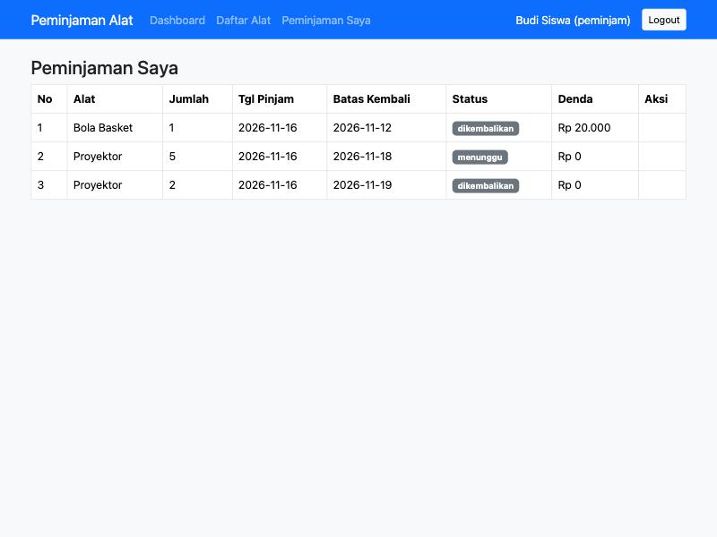
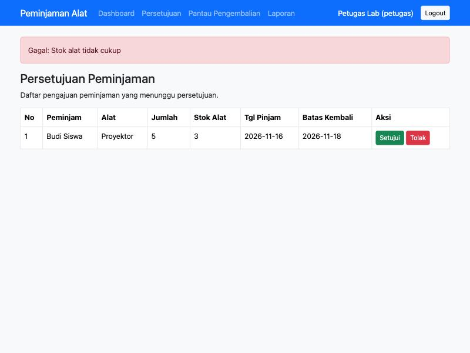
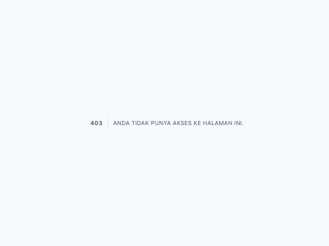

*Setup: MacBook Apple Silicon, PHP 8.2, Laravel 12, MySQL 8.0.30, Bootstrap 5.3 via CDN. Semua langkah juga bisa diikuti di Windows dengan Laragon atau XAMPP. Artikel ini berbahasa Indonesia karena ditulis untuk siswa SMK.*

**[Download semua (modul + kode Laravel + file .sql + dokumentasi), zip 340 KB](/downloads/modulUKK-peminjaman-alat-laravel12.zip)** · **[Baca modulnya online, mulai dari BAB 00](/modul-laravel-peminjaman-alat/)**

Artikel ini menjelaskan cara membuat **projek Laravel 12 CRUD peminjaman alat** dari nol sampai selesai. Projeknya dibuat untuk soal **UKK RPL 2025/2026 Paket 1 (Pengembangan Aplikasi Peminjaman Alat)**. Ada aplikasinya yang sudah jadi dan sudah diuji, ada modul 14 bab yang bisa kamu ikuti sambil mengetik kodenya sendiri, dan ada semua dokumen yang diminta soal: ERD, flowchart, dokumentasi fungsi, debugging, pengujian dan laporan evaluasi.

Kodenya sengaja dibuat **sesederhana mungkin**. Polanya hanya route → controller → model → view. Tidak ada service, repository atau package tambahan.



*Halaman "Peminjaman Saya" milik peminjam. Bola Basket dikembalikan terlambat 4 hari, jadi dendanya Rp 20.000 (Rp 5.000 per hari). Semua data di screenshot adalah data uji.*

## Untuk apa

Soal UKK RPL Paket 1 meminta aplikasi peminjaman alat dengan tiga level pengguna, ditambah objek database yang biasanya jarang dipakai di tugas sekolah: stored procedure, function, trigger, serta commit dan rollback. Waktunya 23 jam. Banyak tutorial Laravel hanya membahas CRUD biasa, jadi bagian database dan pembagian role sering bikin bingung.

Modul ini menjawab soal tersebut satu per satu, dengan kode yang sudah dijalankan dan diuji, bukan sekadar contoh.

| Fitur | Admin | Petugas | Peminjam |
|---|:-:|:-:|:-:|
| Login / logout | ✔ | ✔ | ✔ |
| CRUD user, kategori, alat | ✔ | | |
| CRUD peminjaman dan pengembalian | ✔ | | |
| Log aktivitas | ✔ | | |
| Menyetujui / menolak peminjaman | | ✔ | |
| Memantau pengembalian (tanda terlambat) | | ✔ | |
| Mencetak laporan | | ✔ | |
| Melihat dan mencari alat | | | ✔ |
| Mengajukan peminjaman | | | ✔ |
| Mengembalikan alat (denda otomatis) | | | ✔ |

## Daftar isi modul

Ikuti berurutan. Setiap bab diakhiri checklist dan langkah untuk mencobanya di browser.

| Bab | Isi |
|---|---|
| [BAB 00 — Pendahuluan](/modul-laravel-peminjaman-alat/bab-00-pendahuluan/) | Apa yang diminta soal, alur aplikasi, akun uji |
| [BAB 01 — Analisis & Desain](/modul-laravel-peminjaman-alat/bab-01-analisis-dan-desain/) | Analisis kebutuhan, ERD, flowchart |
| [BAB 02 — Instalasi Proyek](/modul-laravel-peminjaman-alat/bab-02-instalasi-proyek/) | Install Laravel 12, setting `.env` dan database MySQL |
| [BAB 03 — Migration](/modul-laravel-peminjaman-alat/bab-03-migration-tabel/) | 6 tabel dengan foreign key |
| [BAB 04 — Function, Procedure, Trigger](/modul-laravel-peminjaman-alat/bab-04-function-procedure-trigger/) | `hitung_denda`, `kembalikan_alat`, `kurangi_stok`, `tambah_stok`, COMMIT/ROLLBACK |
| [BAB 05 — Model & Seeder](/modul-laravel-peminjaman-alat/bab-05-model-dan-seeder/) | Relasi Eloquent, data awal |
| [BAB 06 — Login, Role, Layout](/modul-laravel-peminjaman-alat/bab-06-login-role-layout/) | Login pakai username, middleware role, layout Bootstrap |
| [BAB 07 — CRUD Kategori & Alat](/modul-laravel-peminjaman-alat/bab-07-admin-kategori-alat/) | `Route::resource`, validasi, pagination |
| [BAB 08 — CRUD User](/modul-laravel-peminjaman-alat/bab-08-admin-user/) | Password hash, username unik |
| [BAB 09 — Peminjaman, Pengembalian, Log](/modul-laravel-peminjaman-alat/bab-09-admin-peminjaman-pengembalian-log/) | Memanggil procedure dan function dari Laravel |
| [BAB 10 — Fitur Petugas](/modul-laravel-peminjaman-alat/bab-10-petugas/) | Persetujuan dengan transaksi, pantau pengembalian, cetak laporan |
| [BAB 11 — Fitur Peminjam](/modul-laravel-peminjaman-alat/bab-11-peminjam/) | Cari alat, ajukan pinjam, kembalikan |
| [BAB 12 — Pengujian & Debugging](/modul-laravel-peminjaman-alat/bab-12-pengujian-debugging/) | 15 test case, tabel error yang sering muncul |
| [BAB 13 — Export SQL & Pengumpulan](/modul-laravel-peminjaman-alat/bab-13-export-sql-dan-pengumpulan/) | Export `.sql` dengan routine dan trigger, checklist, tips 23 jam |

Contoh dokumen UKK (bisa dijadikan acuan, jangan disalin mentah-mentah):
[analisis kebutuhan](/modul-laravel-peminjaman-alat/dokumentasi/01-analisis-kebutuhan/) ·
[ERD + kamus data](/modul-laravel-peminjaman-alat/dokumentasi/02-erd/) ·
[flowchart + pseudocode](/modul-laravel-peminjaman-alat/dokumentasi/03-flowchart-pseudocode/) ·
[dokumentasi fungsi](/modul-laravel-peminjaman-alat/dokumentasi/04-dokumentasi-fungsi/) ·
[debugging](/modul-laravel-peminjaman-alat/dokumentasi/05-debugging/) ·
[pengujian](/modul-laravel-peminjaman-alat/dokumentasi/06-pengujian/) ·
[laporan evaluasi](/modul-laravel-peminjaman-alat/dokumentasi/07-laporan-evaluasi/)

## Cara menjalankan projek yang sudah jadi

Kalau kamu cuma ingin mencoba hasil akhirnya dulu:

1. Download dan ekstrak [zip-nya](/downloads/modulUKK-peminjaman-alat-laravel12.zip).
2. Nyalakan MySQL (Laragon, XAMPP, atau lainnya), lalu buat database `db_peminjaman_alat`.
3. Jalankan di folder `peminjaman-alat`:

```bash
composer install
cp .env.example .env
php artisan key:generate
```

4. Di `.env`, ubah bagian database:

```
DB_CONNECTION=mysql
DB_HOST=127.0.0.1
DB_PORT=3306
DB_DATABASE=db_peminjaman_alat
DB_USERNAME=root
DB_PASSWORD=
```

5. Isi database dan jalankan server:

```bash
php artisan migrate --seed
php artisan serve
```

Buka `http://localhost:8000` dan login dengan salah satu akun ini:

| Role | Username | Password |
|---|---|---|
| Admin | `admin` | `admin123` |
| Petugas | `petugas` | `petugas123` |
| Peminjam | `peminjam` | `peminjam123` |

Sebagai ganti `migrate --seed`, kamu juga bisa meng-import [db_peminjaman_alat.sql](/downloads/db_peminjaman_alat.sql) lewat phpMyAdmin. File itu sudah berisi tabel, data awal, function, procedure dan trigger.

## Cara kerjanya

### Alur peminjaman

```
Peminjam                 Petugas                    Database
--------                 -------                    --------
ajukan pinjam  ───────►  status = "menunggu"
                         klik Setujui ───────────►  TRIGGER kurangi_stok  (stok - jumlah)
                                                    status = "disetujui"
klik Kembalikan ───────────────────────────────►   PROCEDURE kembalikan_alat
                                                     ├─ FUNCTION hitung_denda (Rp 5.000/hari telat)
                                                     ├─ simpan ke tabel pengembalian
                                                     ├─ TRIGGER tambah_stok (stok + jumlah)
                                                     └─ status = "dikembalikan"  → COMMIT
```

Satu peminjaman hanya untuk satu jenis alat (dengan jumlah). Dengan begitu tidak perlu tabel detail, dan relasinya tetap mudah dijelaskan saat ditanya penguji.

### Database: 6 tabel, 1 function, 1 procedure, 2 trigger

Tabelnya `users`, `kategori`, `alat`, `peminjaman`, `pengembalian` dan `log_aktivitas`, saling terhubung dengan foreign key. Objek SQL-nya dibuat di dalam migration memakai `DB::unprepared()`, jadi ikut terbuat setiap kali `php artisan migrate` dijalankan.

Function denda, intinya hanya `DATEDIFF`:

```sql
CREATE FUNCTION hitung_denda(p_batas DATE, p_kembali DATE)
RETURNS INT
DETERMINISTIC
BEGIN
    DECLARE telat INT;
    SET telat = DATEDIFF(p_kembali, p_batas);
    IF telat > 0 THEN
        RETURN telat * 5000;
    END IF;
    RETURN 0;
END
```

Stored procedure pengembalian memakai transaksi. Kalau ada satu langkah yang gagal, `EXIT HANDLER` menjalankan `ROLLBACK` lalu meneruskan error-nya ke Laravel:

```sql
DECLARE EXIT HANDLER FOR SQLEXCEPTION
BEGIN
    ROLLBACK;
    RESIGNAL;
END;

START TRANSACTION;
  -- ambil batas_kembali, INSERT ke pengembalian (denda = hitung_denda(...)),
  -- UPDATE status peminjaman = 'dikembalikan'
COMMIT;
```

Trigger `kurangi_stok` hanya berjalan saat status **berubah** menjadi `disetujui` (`OLD.status <> 'disetujui' AND NEW.status = 'disetujui'`). Jadi menyimpan ulang data yang sudah disetujui tidak mengurangi stok dua kali.

Dari Laravel, procedure dan function dipanggil seperti ini:

```php
DB::statement('CALL kembalikan_alat(?, ?)', [$peminjaman->id, date('Y-m-d')]);

$hasil = DB::selectOne('SELECT hitung_denda(?, ?) AS denda', [$batas, $tanggal]);
```

### Commit dan rollback di sisi Laravel

Saat petugas menyetujui peminjaman, pengecekan status dan stok dibungkus dalam transaksi:

```php
DB::beginTransaction();
try {
    if ($peminjaman->status != 'menunggu') {
        throw new \Exception('Peminjaman ini sudah diproses');
    }
    if ($peminjaman->alat->stok < $peminjaman->jumlah) {
        throw new \Exception('Stok alat tidak cukup');
    }
    // stok alat otomatis berkurang oleh TRIGGER kurangi_stok
    $peminjaman->update([
        'status' => 'disetujui',
        'petugas_id' => auth()->id(),
    ]);
    LogAktivitas::catat('Menyetujui peminjaman #' . $peminjaman->id);
    DB::commit();
    return back()->with('success', 'Peminjaman disetujui');
} catch (\Exception $e) {
    DB::rollBack();
    return back()->with('error', 'Gagal: ' . $e->getMessage());
}
```



*TC08: petugas menyetujui pinjaman 5 unit saat stok tinggal 1. Muncul "Gagal: Stok alat tidak cukup", status tetap `menunggu` dan stok tidak berubah karena transaksinya di-rollback.*

### Hak akses per role

Satu middleware kecil, `CekRole`, didaftarkan sebagai alias `role` di `bootstrap/app.php`. Route admin dibungkus `middleware('role:admin')`, dan begitu juga untuk petugas dan peminjam. Kalau peminjam membuka `/admin/user`, hasilnya halaman **403**.



### Query yang efisien

Soal poin 8 meminta query efisien. Semua daftar data memakai `paginate()` (otomatis `LIMIT`) dan `with()` (eager loading), misalnya `Peminjaman::with('user', 'alat')->latest()->paginate(10)`. Tidak ada query di dalam perulangan `@foreach`.

## Catatan kesulitan (logbook)

Bagian ini mencatat masalah yang benar-benar terjadi saat membuat projek ini, beserta cara menyelesaikannya. Kalau kamu menemui error yang sama, langsung lihat di sini.

### 1. `migrate:fresh` gagal: FUNCTION hitung_denda already exists

- **Gejala:** menjalankan `php artisan migrate:fresh --seed` untuk kedua kalinya gagal dengan `SQLSTATE[42000]: ... 1304 FUNCTION hitung_denda already exists`.
- **Yang tidak berhasil:** menjalankan ulang perintah yang sama. Hasilnya tetap error, karena masalahnya ada di database, bukan di kode Laravel.
- **Cara menemukan:** pesan error di terminal sudah menyebut nama function-nya. `migrate:fresh` hanya menghapus **tabel**, sedangkan function dan procedure tetap tersimpan di database.
- **Perbaikan:** tambahkan baris ini di awal `up()` migration:

  ```php
  DB::unprepared('DROP FUNCTION IF EXISTS hitung_denda');
  DB::unprepared('DROP PROCEDURE IF EXISTS kembalikan_alat');
  ```

  Trigger tidak perlu, karena trigger ikut terhapus bersama tabelnya.
- **Verifikasi:** `migrate:fresh --seed` dijalankan ulang beberapa kali tanpa error, dan file `.sql` hasil export berisi function, procedure dan kedua trigger.
- **Pelajaran:** "fresh" di Laravel artinya tabel baru, bukan database baru. Objek SQL lain harus kamu bersihkan sendiri.

### 2. Semua halaman role error 500: Target class CekRole does not exist

- **Gejala:** setelah route diberi `middleware('role:...')`, semua halaman admin, petugas dan peminjam error 500. Hanya login yang jalan.
- **Cara menemukan:** isi `storage/logs/laravel.log` paling bawah: `Target class [App\Http\Middleware\CekRole] does not exist`.
- **Penyebab:** beberapa perintah dirangkai dengan `&&`. Perintah migrate di tengahnya gagal (masalah no. 1), jadi perintah setelahnya, termasuk `make:middleware CekRole`, tidak pernah dijalankan. File middleware-nya memang tidak ada.
- **Perbaikan:** jalankan lagi `php artisan make:middleware CekRole`, lalu isi kodenya.
- **Verifikasi:** setiap role bisa membuka halamannya sendiri, dan membuka halaman role lain menghasilkan 403.
- **Pelajaran:** kalau ada error aneh setelah sebuah perintah gagal, cek dulu apakah file yang seharusnya dibuat memang sudah ada.

### 3. 419 Page Expired setelah reset database

- **Gejala:** setelah `migrate:fresh`, klik tombol Login di tab browser yang masih terbuka menghasilkan **419 Page Expired**.
- **Penyebab:** `SESSION_DRIVER=database`, jadi tabel `sessions` ikut di-reset. Token CSRF di halaman lama sudah tidak berlaku.
- **Perbaikan:** cukup refresh halaman login. Ini bukan bug kode. Peringatannya sudah ditulis di modul, supaya tidak panik saat UKK.
- **Pelajaran:** 419 hampir selalu masalah token CSRF: lupa `@csrf`, atau sesi sudah tidak ada.

### 4. Username hilang setelah login gagal

- **Gejala:** saat uji TC01 (password salah), pesan error muncul, tetapi kolom username ikut kosong.
- **Perbaikan:** `back()` diganti menjadi `back()->withInput()->with('error', 'Username atau password salah!')`, dan input memakai `value="{{ old('username') }}"`.
- **Verifikasi:** TC01 diulang, username tetap terisi.
- **Pelajaran:** test case bukan hanya untuk mencari error, tapi juga untuk menemukan hal kecil yang mengganggu pengguna.

### 5. Langkah uji denda di modul ternyata salah

- **Gejala:** instruksi awal di modul berbunyi "admin edit peminjaman, ubah **Batas Kembali** ke 5 hari lalu". Kalau diikuti, form-nya ditolak oleh validasi.
- **Penyebab:** validasi `batas_kembali` memakai `after_or_equal:tanggal_pinjam`. Batas kembali di masa lalu lebih awal dari tanggal pinjam hari ini, jadi ditolak. Validasinya benar, instruksinya yang salah.
- **Perbaikan:** instruksi di BAB 11 dan TC10 di BAB 12 diubah. Sekarang **Tanggal Pinjam** juga dimundurkan (7 hari lalu), lalu Batas Kembali diisi 4 hari lalu.
- **Verifikasi:** langkah baru diikuti persis lewat HTTP, dan hasilnya denda Rp 20.000 (telat 4 hari × Rp 5.000).
- **Pelajaran:** instruksi uji juga harus diuji. Jangan cuma kodenya.

### 6. Menjaga agar kode di modul sama persis dengan kode yang diuji

- **Masalah:** modul ini berisi kode lengkap puluhan file (migration, model, controller, view). Kalau kode disalin manual ke modul, satu perbaikan di proyek mudah lupa ikut diperbarui di modul. Akibatnya siswa mengetik kode yang sudah usang.
- **Solusi:** bab modul ditulis sebagai template dengan penanda `@@FILE:app/Http/Controllers/...@@`. Sebuah skrip kecil mengganti penanda itu dengan isi file asli dari proyek, lalu melaporkan file proyek mana yang belum masuk modul.
- **Verifikasi:** laporan build terakhir menyatakan semua file kode proyek sudah tercakup, dan semua link antar bab valid.
- **Pelajaran:** kalau dokumen berisi kode, generate dari sumbernya, jangan disalin dengan tangan.

### 7. Potensi stok berkurang dua kali (diantisipasi)

- **Masalah:** kalau tombol **Setujui** diklik dua kali dengan cepat, stok bisa terpotong dua kali.
- **Perbaikan:** ada dua lapis. Controller menolak kalau status sudah bukan `menunggu`, dan trigger hanya berjalan saat status berubah dari bukan-disetujui menjadi disetujui.
- **Status:** dicegah di kode. Uji khusus klik ganda dari dua tab bersamaan **belum** dilakukan.

## Prinsip yang bisa dipakai lagi

1. Desain dulu (ERD, flowchart), baru ngoding. Di UKK, jam 1–3 untuk analisis.
2. Satu pola untuk semua fitur: route → controller → model → view.
3. Taruh logika penting (denda, stok) di database lewat function dan trigger. Hasilnya konsisten dari mana pun data diubah, dan memang diminta soal.
4. Bungkus proses yang terdiri dari beberapa langkah dengan transaksi. Gagal satu, batal semua.
5. Setiap migration yang membuat function atau procedure harus diawali `DROP ... IF EXISTS`.
6. Setelah selesai satu bab, langsung coba di browser. Jangan menumpuk error sampai akhir.
7. Export `.sql` paling akhir, dengan `--routines --triggers`, supaya function, procedure dan trigger ikut.

## Apa yang sudah dan belum diuji

**Sudah diuji (semua berhasil):**

- 15/15 test case aplikasi lewat HTTP: login gagal dan benar, tambah alat valid dan kosong, ajukan pinjam, pinjam melebihi stok, setujui, setujui dengan stok kurang (rollback), kembalikan tepat waktu, kembalikan terlambat (Rp 20.000), privilege peminjam dan petugas (403), akses tanpa login, cetak laporan, log aktivitas. Selain itu, edit tanggal pengembalian oleh admin menghitung ulang denda menjadi Rp 10.000.
- 5/5 uji database langsung di MySQL: `hitung_denda('2026-11-10', '2026-11-13')` = 15000; `hitung_denda('2026-11-10', '2026-11-09')` = 0; trigger mengurangi stok 3 → 1 saat disetujui; `CALL kembalikan_alat(1, '2026-11-13')` menyimpan denda 15000, stok kembali 1 → 3; `CALL kembalikan_alat(999, ...)` → error FK → ROLLBACK, tabel pengembalian tidak bertambah.
- 46 route terdaftar sesuai rencana (`php artisan route:list`).
- File `.sql` sudah di-import ulang ke database kosong dan semua objek (6 tabel, function, procedure, 2 trigger) muncul.

**Belum diuji:**

- Belum dijalankan di Windows (Laragon/XAMPP). Langkahnya standar Laravel, tapi belum dicoba langsung.
- Belum diuji di komputer tanpa internet. Bootstrap diambil dari CDN, jadi tanpa internet tampilannya polos, tapi aplikasinya tetap jalan.
- Belum ada pengujian otomatis (PHPUnit). Semua pengujian dilakukan manual dan lewat skrip HTTP.

## Keterbatasan yang diketahui

Ini sengaja dibiarkan supaya kode tetap sederhana, dan dicatat di [laporan evaluasi](/modul-laravel-peminjaman-alat/dokumentasi/07-laporan-evaluasi/). Soal UKK juga memang meminta bagian "bug yang belum diperbaiki".

1. Kalau admin mengubah alat atau jumlah pada peminjaman yang sudah disetujui, stok tidak disesuaikan ulang.
2. Mengubah status dari `disetujui` kembali ke `menunggu` atau `ditolak` tidak mengembalikan stok.
3. Admin yang menyetujui lewat menu CRUD tidak dicek stoknya. Pengecekan stok hanya ada di fitur persetujuan petugas.
4. Menghapus data pengembalian tidak mengembalikan status peminjaman dan stok.
5. Menghapus kategori atau alat ikut menghapus riwayat peminjamannya (cascade).
6. Pesan validasi masih berbahasa Inggris, bawaan Laravel.

## Pertanyaan yang sering muncul

**Apakah harus pakai Laravel 12?** Modul ini ditulis dan diuji dengan Laravel 12. Laravel 11 strukturnya hampir sama, termasuk `bootstrap/app.php` untuk mendaftarkan middleware. Laravel 10 ke bawah mendaftarkan middleware di `app/Http/Kernel.php`.

**Boleh pakai XAMPP?** Boleh. Yang dibutuhkan hanya PHP 8.2 ke atas, Composer dan MySQL. Pastikan versi PHP di XAMPP sudah 8.2 atau lebih baru.

**Kenapa login pakai username, bukan email?** Supaya lebih mudah saat demo ke penguji. Kolom `email` bawaan diganti `username` di migration users, lalu `Auth::attempt` diberi `username` dan `password`.

**Bagaimana kalau export dari phpMyAdmin tapi function dan trigger tidak ikut?** Pilih Export → Custom, lalu centang *Add CREATE PROCEDURE / FUNCTION / EVENT statement*. Detailnya ada di [BAB 13](/modul-laravel-peminjaman-alat/bab-13-export-sql-dan-pengumpulan/).

## Download

| File | Isi | Ukuran | SHA-256 |
|---|---|---|---|
| [modulUKK-peminjaman-alat-laravel12.zip](/downloads/modulUKK-peminjaman-alat-laravel12.zip) | Modul BAB 00–13, projek Laravel (tanpa `vendor/`), dokumentasi + screenshot, file `.sql` | 340 KB | `089938a900bbd333fd640492011257c3f0e2f1817b67876d06ef52e572ba3511` |
| [db_peminjaman_alat.sql](/downloads/db_peminjaman_alat.sql) | Dump MySQL saja: tabel, data awal, function, procedure, trigger | 21 KB | `442ecb5eb288638d3f19f2de079c68fd14375e5b4014cf29bea38efe1a3bf5de` |

Folder `vendor/` (sekitar 86 MB) tidak disertakan. Jalankan `composer install` untuk membuatnya lagi. File soal asli (PDF) juga tidak disertakan. Mintalah ke guru atau sekolahmu.

## Lisensi

Kode dan modul dirilis dengan lisensi MIT. Silakan dipakai untuk belajar dan latihan UKK. Saran: **ketik ulang sendiri, jangan cuma di-copy**, karena penguji bisa menanyakan setiap baris kodenya.

*Ditulis oleh Panca Walendra Putra dan Claude Opus 5.5 (Anthropic), dari sesi pembuatan projek yang sebenarnya.*
