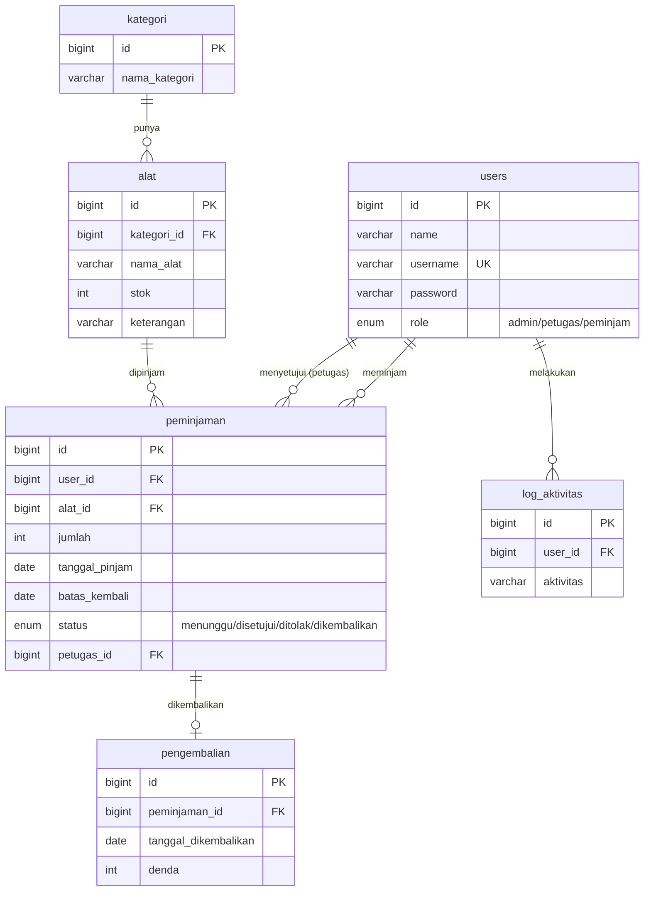

*Bagian dari seri [Cara Membuat Projek Laravel 12 CRUD Peminjaman Alat](/2026/11/16/cara-membuat-projek-laravel-12-crud-peminjaman-alat/). [Daftar isi](/modul-laravel-peminjaman-alat/) · [Download kode lengkap](/downloads/modulUKK-peminjaman-alat-laravel12.zip)*


Soal meminta metode **Waterfall sederhana**:

1. Analisis Kebutuhan → *bab ini*
2. Desain (ERD, flowchart) → *bab ini*
3. Implementasi kode → BAB 02 – 11
4. Pengujian → BAB 12
5. Dokumentasi → BAB 13 + folder `dokumentasi/`

> Di UKK, kerjakan bab ini **di kertas / Word dulu** sebelum ngoding. Penguji biasanya melihat apakah ERD-mu cocok dengan database-mu.

---

## 1. Analisis Kebutuhan

### Pengguna
| Pengguna | Tugas |
|---|---|
| Admin | Mengelola semua data master (user, kategori, alat) & transaksi, melihat log |
| Petugas | Menyetujui/menolak pengajuan, memantau pengembalian, mencetak laporan |
| Peminjam | Melihat alat, mengajukan pinjam, mengembalikan alat |

### Kebutuhan Fungsional (apa yang bisa dilakukan aplikasi)
- Login & logout untuk 3 role, setiap role hanya bisa membuka menunya sendiri.
- CRUD user, kategori, alat, peminjaman, pengembalian (admin).
- Semua aktivitas penting tercatat di log.
- Peminjam mengajukan pinjam → status `menunggu`.
- Petugas menyetujui → status `disetujui`, stok berkurang. Menolak → `ditolak`.
- Peminjam mengembalikan → status `dikembalikan`, stok bertambah, denda dihitung otomatis **Rp 5.000/hari** keterlambatan.
- Petugas mencetak laporan peminjaman per periode tanggal.

### Kebutuhan Non-Fungsional
- Password disimpan terenkripsi (hash).
- Halaman cepat: query pakai `with()` (eager loading) dan `paginate()` (LIMIT).
- Tampilan responsif (Bootstrap).

### Kebutuhan Perangkat
- PHP 8.2+, Composer, MySQL 8 (Laragon / XAMPP / DevStack), browser, VS Code.

---

## 2. Desain Database (ERD)

Ada 6 tabel:



> Diagram di atas memakai **Mermaid**. Di VS Code, install extension *Markdown Preview Mermaid Support* agar gambarnya tampil. Untuk laporan, gambar ulang ERD di draw.io lalu screenshot.

### Cara membaca relasi
- `kategori 1 — N alat` → satu kategori punya banyak alat (`alat.kategori_id`).
- `users 1 — N peminjaman` → satu peminjam bisa pinjam berkali-kali (`peminjaman.user_id`).
- `alat 1 — N peminjaman` → satu alat bisa dipinjam berkali-kali (`peminjaman.alat_id`).
- `peminjaman 1 — 1 pengembalian` → satu peminjaman punya satu data pengembalian.
- `users 1 — N log_aktivitas`.

> **Kenapa dibuat simpel:** satu peminjaman = satu jenis alat (boleh jumlah > 1). Tidak perlu tabel detail. Cukup untuk soal UKK dan jauh lebih mudah dikerjakan.

---

## 3. Flowchart / Pseudocode

Soal minta minimal 3 proses. Versi lengkapnya (flowchart + pseudocode) ada di
[`dokumentasi/03-flowchart-pseudocode.md`](/modul-laravel-peminjaman-alat/dokumentasi/03-flowchart-pseudocode/). Ringkasannya:

**a. Login**
```
MULAI
  input username, password
  JIKA username & password cocok di tabel users
      simpan sesi, catat log "Login", buka dashboard
  SELAIN ITU
      tampilkan "Username atau password salah!"
SELESAI
```

**b. Peminjaman alat**
```
MULAI
  peminjam pilih alat, isi jumlah & tanggal kembali
  JIKA jumlah > stok  → tampilkan error
  SELAIN ITU simpan peminjaman status "menunggu"
  petugas klik Setujui:
     JIKA stok cukup → status "disetujui", stok - jumlah (trigger), COMMIT
     SELAIN ITU      → ROLLBACK, tampilkan "Stok alat tidak cukup"
SELESAI
```

**c. Pengembalian & denda**
```
MULAI
  peminjam klik Kembalikan
  telat = tanggal_dikembalikan - batas_kembali (hari)
  JIKA telat > 0 → denda = telat × 5000  SELAIN ITU denda = 0
  simpan pengembalian, stok + jumlah (trigger), status "dikembalikan", COMMIT
SELESAI
```

---

## ✅ Checklist Bab 01
- [ ] Tabel analisis kebutuhan sudah ditulis
- [ ] ERD sudah digambar (6 tabel + relasi)
- [ ] 3 flowchart/pseudocode sudah dibuat

Lanjut ke **[BAB 02 — Instalasi Proyek](/modul-laravel-peminjaman-alat/bab-02-instalasi-proyek/)**.


---

[← BAB 00 — Pendahuluan](/modul-laravel-peminjaman-alat/bab-00-pendahuluan/) · [Daftar isi](/modul-laravel-peminjaman-alat/) · [BAB 02 — Instalasi Proyek Laravel →](/modul-laravel-peminjaman-alat/bab-02-instalasi-proyek/)

<script type="module">
import mermaid from "https://cdn.jsdelivr.net/npm/mermaid@11.4.1/dist/mermaid.esm.min.mjs";
document.querySelectorAll(".language-mermaid code, code.language-mermaid").forEach(function (code) {
  var box = code.closest("div.language-mermaid") || code.parentElement;
  var div = document.createElement("div");
  div.className = "mermaid";
  div.textContent = code.textContent;
  box.replaceWith(div);
});
mermaid.initialize({ startOnLoad: false });
mermaid.run();
</script>
