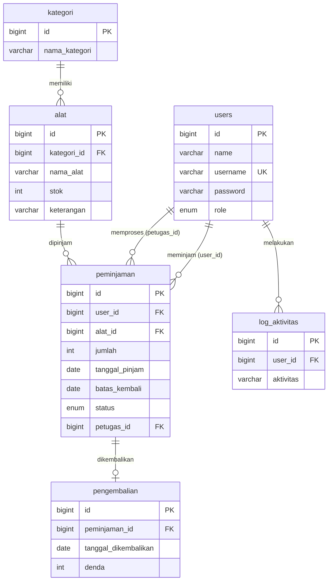

*Bagian dari seri [Cara Membuat Projek Laravel 12 CRUD Peminjaman Alat](/2026/11/16/cara-membuat-projek-laravel-12-crud-peminjaman-alat/). [Daftar isi](/modul-laravel-peminjaman-alat/) · [Download kode lengkap](/downloads/modulUKK-peminjaman-alat-laravel12.zip)*


Nama database: `db_peminjaman_alat`

## 2.1 ERD

## 2.2 Relasi
| Relasi | Kardinalitas | Foreign key | Aksi saat parent dihapus |
|---|---|---|---|
| kategori → alat | 1 : N | `alat.kategori_id` | CASCADE |
| users → peminjaman (peminjam) | 1 : N | `peminjaman.user_id` | CASCADE |
| users → peminjaman (petugas) | 1 : N | `peminjaman.petugas_id` | SET NULL |
| alat → peminjaman | 1 : N | `peminjaman.alat_id` | CASCADE |
| peminjaman → pengembalian | 1 : 1 | `pengembalian.peminjaman_id` | CASCADE |
| users → log_aktivitas | 1 : N | `log_aktivitas.user_id` | SET NULL |

## 2.3 Kamus Data
Semua tabel juga punya kolom `created_at` dan `updated_at` (timestamp).

**users**
| Kolom | Tipe | Keterangan |
|---|---|---|
| id | BIGINT UNSIGNED, PK, AI | |
| name | VARCHAR(255) | nama lengkap |
| username | VARCHAR(255), UNIQUE | untuk login |
| password | VARCHAR(255) | hash bcrypt |
| role | ENUM('admin','petugas','peminjam') | default `peminjam` |
| remember_token | VARCHAR(100), NULL | bawaan Laravel |

**kategori**
| Kolom | Tipe | Keterangan |
|---|---|---|
| id | BIGINT UNSIGNED, PK, AI | |
| nama_kategori | VARCHAR(255) | |

**alat**
| Kolom | Tipe | Keterangan |
|---|---|---|
| id | BIGINT UNSIGNED, PK, AI | |
| kategori_id | BIGINT UNSIGNED, FK → kategori.id | |
| nama_alat | VARCHAR(255) | |
| stok | INT | default 0 |
| keterangan | VARCHAR(255), NULL | |

**peminjaman**
| Kolom | Tipe | Keterangan |
|---|---|---|
| id | BIGINT UNSIGNED, PK, AI | |
| user_id | BIGINT UNSIGNED, FK → users.id | peminjam |
| alat_id | BIGINT UNSIGNED, FK → alat.id | |
| jumlah | INT | jumlah unit |
| tanggal_pinjam | DATE | |
| batas_kembali | DATE | tanggal harus kembali |
| status | ENUM('menunggu','disetujui','ditolak','dikembalikan') | default `menunggu` |
| petugas_id | BIGINT UNSIGNED, FK → users.id, NULL | petugas yang memproses |

**pengembalian**
| Kolom | Tipe | Keterangan |
|---|---|---|
| id | BIGINT UNSIGNED, PK, AI | |
| peminjaman_id | BIGINT UNSIGNED, FK → peminjaman.id | |
| tanggal_dikembalikan | DATE | |
| denda | INT | hasil `hitung_denda()` |

**log_aktivitas**
| Kolom | Tipe | Keterangan |
|---|---|---|
| id | BIGINT UNSIGNED, PK, AI | |
| user_id | BIGINT UNSIGNED, FK → users.id, NULL | pelaku |
| aktivitas | VARCHAR(255) | deskripsi aksi |

## 2.4 Objek Database Tambahan
| Nama | Jenis | Fungsi |
|---|---|---|
| `hitung_denda(p_batas, p_kembali)` | FUNCTION | Mengembalikan denda = hari terlambat × 5.000 |
| `kembalikan_alat(p_peminjaman_id, p_tanggal)` | STORED PROCEDURE | Simpan pengembalian + denda, ubah status; memakai START TRANSACTION, COMMIT, ROLLBACK |
| `kurangi_stok` | TRIGGER (AFTER UPDATE peminjaman) | Stok − jumlah saat status berubah menjadi `disetujui` |
| `tambah_stok` | TRIGGER (AFTER INSERT pengembalian) | Stok + jumlah saat alat dikembalikan |


---

[← 1. Analisis Kebutuhan — Aplikasi Peminjaman Alat](/modul-laravel-peminjaman-alat/dokumentasi/01-analisis-kebutuhan/) · [Daftar isi](/modul-laravel-peminjaman-alat/) · [3. Flowchart dan Pseudocode →](/modul-laravel-peminjaman-alat/dokumentasi/03-flowchart-pseudocode/)

