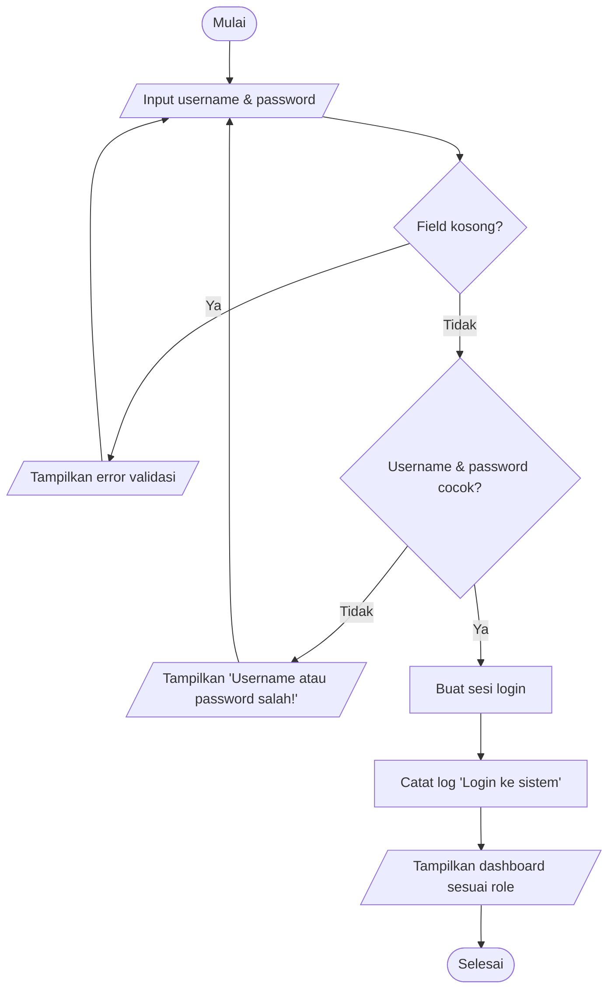
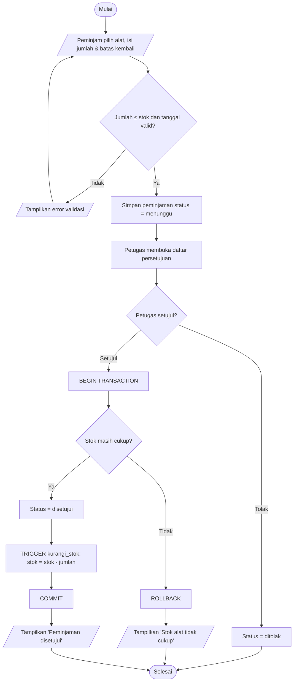
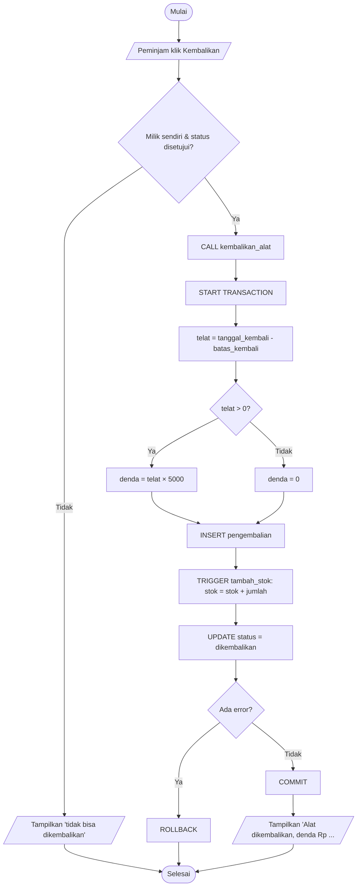

*Bagian dari seri [Cara Membuat Projek Laravel 12 CRUD Peminjaman Alat](/2026/11/16/cara-membuat-projek-laravel-12-crud-peminjaman-alat/). [Daftar isi](/modul-laravel-peminjaman-alat/) · [Download kode lengkap](/downloads/modulUKK-peminjaman-alat-laravel12.zip)*


> Flowchart ditulis dengan Mermaid. Untuk laporan Word, gambar ulang di draw.io / Word Shapes dengan simbol standar:
> oval = mulai/selesai, jajar genjang = input/output, persegi = proses, belah ketupat = keputusan.

---

## 3.1 Proses Login

**Deskripsi:** pengguna memasukkan username dan password. Sistem mencocokkan dengan tabel `users` (password dicek dalam bentuk hash). Jika cocok, sesi dibuat, aktivitas dicatat, dan pengguna diarahkan ke dashboard sesuai role.



**Pseudocode**
```
PROSEDUR login
    INPUT username, password
    JIKA username kosong ATAU password kosong MAKA
        TAMPILKAN "field wajib diisi"
        KEMBALI ke form login
    AKHIR JIKA
    user ← CARI di tabel users DENGAN username
    JIKA user ada DAN cek_hash(password, user.password) MAKA
        buat sesi untuk user
        catat_log("Login ke sistem")
        ARAHKAN ke dashboard
    SELAIN ITU
        TAMPILKAN "Username atau password salah!"
    AKHIR JIKA
AKHIR PROSEDUR
```

---

## 3.2 Proses Peminjaman Alat

**Deskripsi:** peminjam memilih alat dan mengisi jumlah serta tanggal kembali. Pengajuan disimpan dengan status `menunggu`. Petugas lalu menyetujui atau menolak. Saat disetujui, sistem memakai transaksi: jika stok cukup, status diubah dan trigger `kurangi_stok` mengurangi stok lalu COMMIT; jika tidak, ROLLBACK.



**Pseudocode**
```
PROSEDUR ajukan_peminjaman(alat)
    INPUT jumlah, batas_kembali
    JIKA jumlah < 1 ATAU jumlah > alat.stok ATAU batas_kembali < hari_ini MAKA
        TAMPILKAN error, KEMBALI
    AKHIR JIKA
    SIMPAN peminjaman(user_login, alat, jumlah, hari_ini, batas_kembali, "menunggu")
    catat_log("Mengajukan peminjaman")
AKHIR PROSEDUR

PROSEDUR setujui(peminjaman)
    MULAI TRANSAKSI
    COBA
        JIKA peminjaman.status ≠ "menunggu" MAKA LEMPAR "sudah diproses"
        JIKA alat.stok < peminjaman.jumlah MAKA LEMPAR "Stok alat tidak cukup"
        UBAH peminjaman.status ← "disetujui"     // trigger mengurangi stok
        catat_log("Menyetujui peminjaman")
        COMMIT
    TANGKAP error
        ROLLBACK
        TAMPILKAN error
AKHIR PROSEDUR
```

---

## 3.3 Proses Pengembalian Alat dan Perhitungan Denda

**Deskripsi:** peminjam menekan tombol *Kembalikan*. Aplikasi memanggil stored procedure `kembalikan_alat`, yang menghitung denda dengan function `hitung_denda` (Rp 5.000 × hari terlambat), menyimpan data pengembalian (trigger `tambah_stok` menambah stok), lalu mengubah status menjadi `dikembalikan`. Bila terjadi error, seluruh perubahan di-ROLLBACK.



**Pseudocode**
```
FUNGSI hitung_denda(batas, kembali) → INTEGER
    telat ← selisih_hari(kembali, batas)
    JIKA telat > 0 MAKA KEMBALIKAN telat × 5000
    KEMBALIKAN 0
AKHIR FUNGSI

PROSEDUR kembalikan_alat(id_peminjaman, tanggal)
    JIKA terjadi error MAKA ROLLBACK
    MULAI TRANSAKSI
    batas ← AMBIL batas_kembali DARI peminjaman DENGAN id_peminjaman
    SIMPAN pengembalian(id_peminjaman, tanggal, hitung_denda(batas, tanggal))
        // trigger tambah_stok: alat.stok ← alat.stok + jumlah
    UBAH peminjaman.status ← "dikembalikan"
    COMMIT
AKHIR PROSEDUR
```


---

[← 2. Desain Database (ERD)](/modul-laravel-peminjaman-alat/dokumentasi/02-erd/) · [Daftar isi](/modul-laravel-peminjaman-alat/) · [4. Deskripsi Program dan Dokumentasi Fungsi / Prosedur →](/modul-laravel-peminjaman-alat/dokumentasi/04-dokumentasi-fungsi/)

<script type="module">
import mermaid from "https://cdn.jsdelivr.net/npm/mermaid@11.4.1/dist/mermaid.esm.min.mjs";
document.querySelectorAll(".language-mermaid code, code.language-mermaid").forEach(function (code) {
  var box = code.closest("div.language-mermaid") || code.parentElement;
  var div = document.createElement("div");
  div.className = "mermaid";
  div.textContent = code.textContent;
  box.replaceWith(div);
});
mermaid.initialize({ startOnLoad: false });
mermaid.run();
</script>
