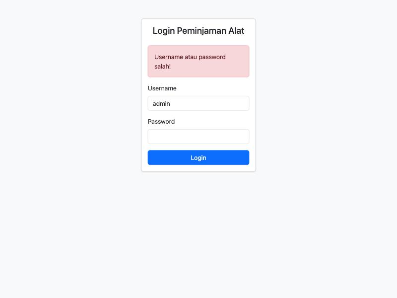
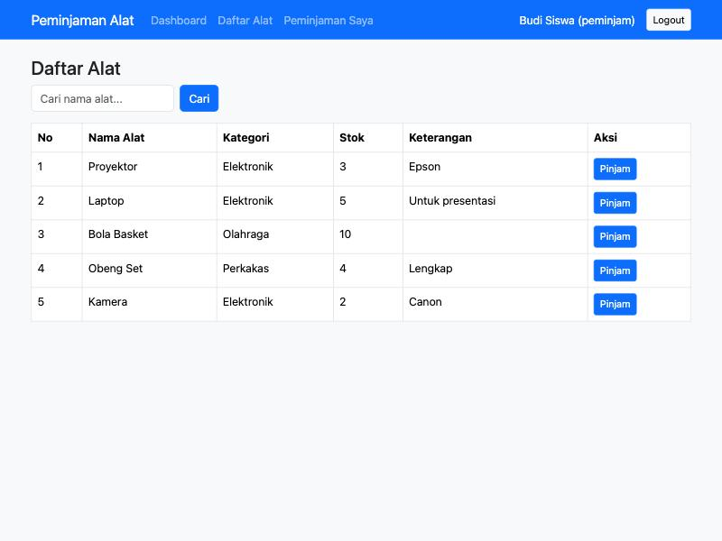
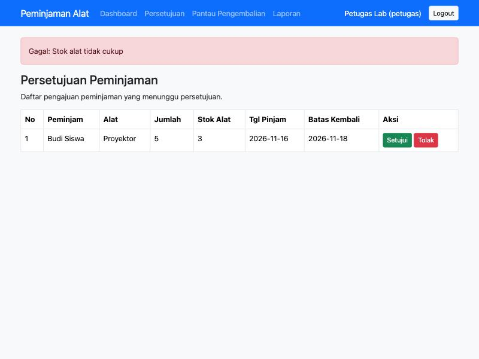
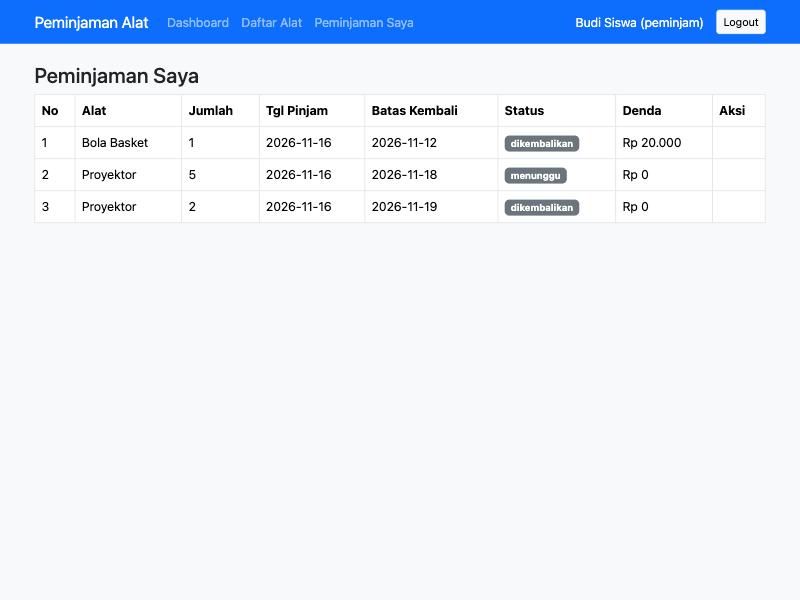
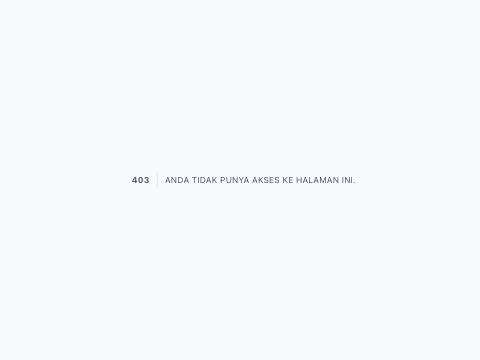
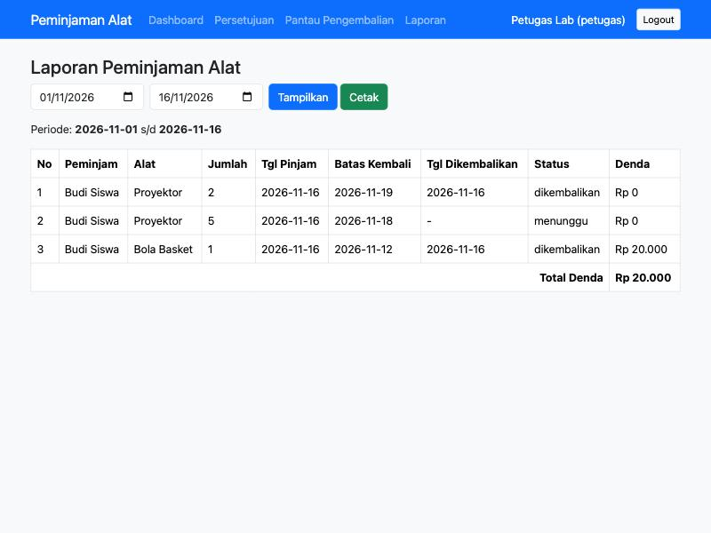

*Bagian dari seri [Cara Membuat Projek Laravel 12 CRUD Peminjaman Alat](/2026/11/16/cara-membuat-projek-laravel-12-crud-peminjaman-alat/). [Daftar isi](/modul-laravel-peminjaman-alat/) · [Download kode lengkap](/downloads/modulUKK-peminjaman-alat-laravel12.zip)*


**Metode:** Black box testing (menguji dari sisi pengguna: input → hasil).
**Data awal:** `php artisan migrate:fresh --seed`
**Tanggal uji:** 16 November 2026

| Kode | Skenario | Langkah | Hasil yang diharapkan | Hasil sebenarnya | Status |
|---|---|---|---|---|---|
| TC01 | Login dengan password salah | `admin` / `salah123` | Gagal, muncul notifikasi | Muncul "Username atau password salah!", username tetap terisi | ✅ Berhasil |
| TC02 | Login benar | `admin` / `admin123` | Masuk dashboard | Diarahkan ke `/dashboard`, menu admin tampil | ✅ Berhasil |
| TC03 | Tambah alat valid | Kamera, Elektronik, stok 2 | Data tersimpan | Muncul "Alat berhasil ditambah", data tampil di tabel | ✅ Berhasil |
| TC04 | Tambah alat kosong | Simpan tanpa isi | Gagal + pesan validasi | Muncul 3 pesan: kategori, nama alat, stok wajib diisi | ✅ Berhasil |
| TC05 | Ajukan pinjam | Peminjam pinjam Proyektor jumlah 2 | Status menunggu | Muncul "Pengajuan berhasil, tunggu persetujuan petugas", status `menunggu` | ✅ Berhasil |
| TC06 | Pinjam melebihi stok | Jumlah 99 | Gagal | Muncul "The jumlah field must not be greater than 3." | ✅ Berhasil |
| TC07 | Petugas setujui | Klik Setujui | Status disetujui, stok berkurang | Status `disetujui`, stok Proyektor 3 → 1 | ✅ Berhasil |
| TC08 | Setujui saat stok kurang | Pinjaman jumlah 5, stok 1 → Setujui | Gagal, data tidak berubah | Muncul "Gagal: Stok alat tidak cukup", status tetap `menunggu`, stok tetap (ROLLBACK) | ✅ Berhasil |
| TC09 | Kembalikan tepat waktu | Peminjam klik Kembalikan | Denda 0, stok kembali | "Alat berhasil dikembalikan. Denda: Rp 0", status `dikembalikan`, stok 1 → 3 | ✅ Berhasil |
| TC10 | Kembalikan terlambat 4 hari | Batas kembali dimundurkan 4 hari → Kembalikan | Denda Rp 20.000 | "Alat berhasil dikembalikan. Denda: Rp 20.000" | ✅ Berhasil |
| TC11 | Privilege peminjam | Peminjam buka `/admin/user` | Ditolak | HTTP 403 "Anda tidak punya akses ke halaman ini." | ✅ Berhasil |
| TC12 | Privilege petugas | Petugas buka `/admin/alat` | Ditolak | HTTP 403 | ✅ Berhasil |
| TC13 | Akses tanpa login | Buka `/dashboard` tanpa login | Diarahkan ke login | Redirect 302 ke `/login` | ✅ Berhasil |
| TC14 | Cetak laporan | Petugas → Laporan → Cetak | Dialog cetak, total denda benar | Tabel periode + Total Denda Rp 20.000, navbar & filter tidak ikut tercetak | ✅ Berhasil |
| TC15 | Log aktivitas | Admin buka Log Aktivitas | Semua aksi tercatat | Login, tambah alat, ajukan, setujui, kembalikan tercatat lengkap dengan waktu & user | ✅ Berhasil |

**Ringkasan:** 15 dari 15 test case berhasil.

## Uji Database (phpMyAdmin)

| Kode | Perintah | Hasil yang diharapkan | Hasil sebenarnya | Status |
|---|---|---|---|---|
| DB01 | `SELECT hitung_denda('2026-11-10','2026-11-13')` | 15000 | 15000 | ✅ |
| DB02 | `SELECT hitung_denda('2026-11-10','2026-11-09')` | 0 | 0 | ✅ |
| DB03 | `UPDATE peminjaman SET status='disetujui'` (jumlah 2) | Trigger: stok 3 → 1 | stok 1 | ✅ |
| DB04 | `CALL kembalikan_alat(1,'2026-11-13')` | Denda 15000, stok 1 → 3, status dikembalikan | sesuai | ✅ |
| DB05 | `CALL kembalikan_alat(999,'2026-11-13')` | Error, ROLLBACK, tidak ada data tersimpan | error FK, tabel pengembalian tidak bertambah | ✅ |

## Tangkapan Layar

**TC01 — Login gagal**

**TC05 — Daftar alat (peminjam)**

**TC08 — Setujui saat stok tidak cukup (rollback)**

**TC10 — Riwayat peminjam dengan denda Rp 20.000**

**TC12 — Petugas membuka halaman admin (403)**

**TC14 — Laporan petugas**

> Screenshot di atas adalah contoh. Saat UKK, ambil screenshot **sendiri** untuk setiap test case dari aplikasimu.


---

[← 5. Catatan Debugging](/modul-laravel-peminjaman-alat/dokumentasi/05-debugging/) · [Daftar isi](/modul-laravel-peminjaman-alat/) · [7. Laporan Evaluasi Singkat →](/modul-laravel-peminjaman-alat/dokumentasi/07-laporan-evaluasi/)
